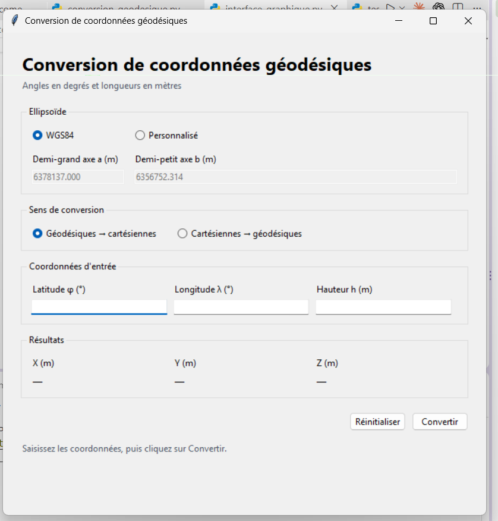

# Conversion de coordonnées géodésiques en Python

Programme pédagogique de géodésie géométrique avec une interface graphique Tkinter, permettant de convertir les coordonnées d’un point dans les deux sens :

$$
(\varphi,\lambda,h) \longleftrightarrow (X,Y,Z)
$$

Ce README documente le programme et les tests proposés. Il ne constitue pas un compte rendu d’exécution : aucun résultat de test exécuté n’est revendiqué ici.

## 1. Objectif et domaine d’utilisation

Les deux représentations décrivent **le même point dans le même repère et avec le même ellipsoïde**. Le programme ne réalise pas de changement de datum, de projection cartographique ou de conversion d’altitude par rapport au niveau de la mer.

| Grandeur | Définition | Unité utilisée |
|---|---|---|
| `X`, `Y`, `Z` | Coordonnées cartésiennes dans un repère centré sur l’ellipsoïde ; X et Y sont dans le plan équatorial, Z pointe vers le pôle Nord | Mètre |
| `latitude_deg` / φ | Angle de la normale à l’ellipsoïde avec le plan de l’équateur | Degré en entrée et sortie |
| `longitude_deg` / λ | Angle orienté depuis le méridien origine, positif vers l’est | Degré en entrée et sortie |
| `h` | Hauteur mesurée suivant la normale, par rapport à l’ellipsoïde | Mètre |
| `a` | Demi-grand axe de l’ellipsoïde | Mètre |
| `b` | Demi-petit axe de l’ellipsoïde | Mètre |
| `e2` | Carré de la première excentricité, noté e² | Sans unité |
| `N` | Rayon de courbure du premier vertical, ou grande normale | Mètre |
| `p` | Distance du point à l’axe des pôles | Mètre |

La méthode inverse est destinée aux points proches de la surface terrestre ou au-dessus. Les points profondément à l’intérieur de l’ellipsoïde sortent du domaine prévu ; le programme ne détecte pas systématiquement ce cas.

## 2. Fichiers et installation

Placer dans le même dossier :

- `conversion_geodesique.py` : fonctions de calcul indépendantes de l’interface.
- `interface_graphique.py` : interface graphique sur une seule fenêtre.
- `test_conversion_geodesique.py` : tests automatiques.
- `README.md` : ce document.

Python 3 suffit. `math`, `tkinter` et `unittest` font partie de la bibliothèque standard : aucune installation avec `pip` n’est nécessaire dans une installation Python classique.

Depuis un terminal ouvert dans ce dossier, lancer l’interface :

```bash
python interface_graphique.py
```

Sous Windows, si la commande `python` n’est pas disponible, essayer :

```bash
py interface_graphique.py
```

La fenêtre permet de choisir l’ellipsoïde, le sens de conversion et les coordonnées. Le bouton **Convertir** affiche les résultats sans fermer l’application. La touche Entrée lance aussi la conversion et le bouton **Réinitialiser** restaure les valeurs initiales.

### Aperçu de l’interface graphique



### Ellipsoïde par défaut : WGS84

$$
a=6378137\ \mathrm{m},\qquad f=\frac{1}{298.257223563},\qquad b=a(1-f)
$$

Le choix personnalisé permet de saisir directement `a` et `b`. Toutes les longueurs doivent être exprimées en mètres. Une virgule ou un point peut servir de séparateur décimal, mais il ne faut pas saisir de séparateur de milliers.

## 3. Fonctions du programme

### `calculer_excentricite(a, b)`

**Rôle :** caractériser la forme de l’ellipsoïde en calculant :

$$
e^2=\frac{a^2-b^2}{a^2}
$$

**Retour :** un nombre nommé `e2`. Il s’agit de e², et non de e. Pour une sphère, `a == b` et `e2 == 0`.

### `calculer_N(latitude, a, e2)`

**Rôle :** calculer la grande normale à la latitude considérée :

$$
N=\frac{a}{\sqrt{1-e^2\sin^2\varphi}}
$$

**Entrée importante :** `latitude` est en **radians**.

**Retour :** `N`, en mètres. Cette longueur dépend de la latitude ; ce n’est ni la hauteur du point ni simplement sa distance au centre.

### `verifier_ellipsoide(a, b)`

**Rôle :** vérifier que les deux demi-axes sont finis et respectent :

$$
0<b\leq a
$$

`math.isfinite()` rejette notamment les valeurs infinies et `NaN`. Si les paramètres sont invalides, la fonction déclenche une `ValueError`. Sinon, elle se termine sans valeur de retour explicite.

Cette vérification accepte aussi une sphère. Elle ne garantit pas à elle seule que tout ellipsoïde extrêmement aplati sera adapté à la méthode itérative choisie.

### `geodesiques_vers_xyz(latitude_deg, longitude_deg, h, a, b)`

**Rôle :** convertir les coordonnées géodésiques en coordonnées cartésiennes.

**Entrées :** latitude et longitude en degrés, hauteur et demi-axes en mètres.

**Étapes :**

1. Vérifier l’ellipsoïde et la présence de nombres finis.
2. Vérifier que la latitude est entre −90° et +90° et la longitude entre −180° et +180°.
3. Convertir les angles en radians avec `math.radians()`.
4. Calculer `e2` et `N`.
5. Appliquer les formules suivantes.

$$
X=(N+h)\cos\varphi\cos\lambda
$$

$$
Y=(N+h)\cos\varphi\sin\lambda
$$

$$
Z=\bigl(N(1-e^2)+h\bigr)\sin\varphi
$$

**Pourquoi ces formules ?** Sur l’ellipsoïde, dans le plan du méridien, le point de départ de la normale a pour coordonnées `N cos φ` et `N(1−e²) sin φ`. Ajouter la hauteur suivant la normale ajoute respectivement `h cos φ` et `h sin φ`. La longitude permet ensuite de décomposer la distance horizontale suivant X et Y.

Aux latitudes exactement égales à ±90°, le programme fixe `X` et `Y` à zéro pour éviter les petits résidus numériques de la fonction cosinus.

**Retour :** le triplet `(X, Y, Z)`, en mètres. Aucune itération n’est nécessaire.

### `xyz_vers_geodesiques(X, Y, Z, a, b)`

**Rôle :** retrouver latitude, longitude et hauteur à partir des coordonnées cartésiennes.

**Étape 1 — Distance à l’axe des pôles**

$$
p=\sqrt{X^2+Y^2}
$$

Le code utilise `math.hypot(X, Y)` pour effectuer ce calcul.

**Étape 2 — Cas particuliers**

| Situation | Traitement |
|---|---|
| `X = Y = Z = 0` | `ValueError` : la représentation géodésique n’est pas unique |
| `X = Y = 0`, `Z > 0` | Latitude +90°, longitude `None`, hauteur `abs(Z) - b` |
| `X = Y = 0`, `Z < 0` | Latitude −90°, longitude `None`, hauteur `abs(Z) - b` |

`None` signifie ici que la longitude est indéterminée sur l’axe des pôles.

**Étape 3 — Longitude**

$$
\lambda=\operatorname{atan2}(Y,X)
$$

`atan2` tient compte du quadrant et évite une division directe par X. L’ordre des arguments est important : **Y puis X**.

**Étape 4 — Estimation initiale de la latitude**

$$
\varphi_0=\operatorname{atan2}\bigl(Z,p(1-e^2)\bigr)
$$

Lorsque h = 0, les formules directes donnent `Z/p = (1−e²) tan φ` hors des pôles. Cette estimation est donc adaptée aux points proches de l’ellipsoïde.

**Étape 5 — Corrections successives**

À chaque itération k :

$$
N_k=\frac{a}{\sqrt{1-e^2\sin^2\varphi_k}}
$$

$$
\varphi_{k+1}=\operatorname{atan2}\left(Z+e^2N_k\sin\varphi_k,p\right)
$$

Cette relation découle des formules directes :

$$
Z+e^2N\sin\varphi=(N+h)\sin\varphi,\qquad p=(N+h)\cos\varphi
$$

On mesure `abs(nouvelle_latitude - latitude)` et on remplace l’ancienne latitude par la nouvelle. Le calcul s’arrête lorsque la différence est inférieure à **10⁻¹² radian**.

Une limite de **50 itérations** évite une boucle sans fin. Dans le code, le `else` placé après le `for` s’exécute seulement si aucun `break` n’a arrêté la boucle : il signale alors la non-convergence par une `ValueError`.

**Étape 6 — Hauteur finale**

$$
h=p\cos\varphi+Z\sin\varphi-a\sqrt{1-e^2\sin^2\varphi}
$$

Cette formule évite la division par `cos φ` de la formule `h = p/cos φ − N`, fragile près des pôles. Elle s’obtient en additionnant `p cos φ` et `Z sin φ` à partir des relations directes.

**Étape 7 — Conversion des unités**

`math.degrees()` convertit les angles calculés en radians vers les degrés.

**Retour :** `(latitude_deg, longitude_deg, h)`.

### Interface graphique

Le fichier `interface_graphique.py` contient la classe `InterfaceConversionGeodesique`. Elle regroupe dans une seule fenêtre :

- le choix entre WGS84 et un ellipsoïde personnalisé ;
- le choix du sens de conversion ;
- les trois champs de coordonnées ;
- les résultats et les messages de validation.

La fonction `convertir_texte_en_nombre()` accepte un point ou une virgule comme séparateur décimal. La méthode `_effectuer_conversion()` lit les champs, appelle les fonctions de calcul et affiche une erreur directement dans la fenêtre si une valeur est absente ou invalide.

Les coordonnées cartésiennes et la hauteur sont affichées avec quatre décimales ; les angles avec dix décimales. Cet affichage arrondit seulement les valeurs visibles.

## 4. Principe des tests automatiques

Le fichier de tests utilise `unittest`. Le test principal réalise un **aller-retour** :

1. Choisir une latitude, une longitude et une hauteur connues.
2. Appeler `geodesiques_vers_xyz()` pour obtenir X, Y et Z.
3. Donner directement ces résultats à `xyz_vers_geodesiques()`.
4. Comparer les coordonnées retrouvées aux coordonnées initiales.

Les valeurs intermédiaires ne sont **pas arrondies** avant leur utilisation par la seconde fonction. Recopier les valeurs affichées dans l’interface introduirait une erreur d’arrondi supplémentaire.

### Exemple

```python
X, Y, Z = geodesiques_vers_xyz(35, -5, 100, a, b)
latitude, longitude, hauteur = xyz_vers_geodesiques(X, Y, Z, a, b)
```

Le résultat attendu est proche de `(35°, -5°, 100 m)`.

## 5. Fonctions et méthodes du fichier de tests

| Élément | Rôle |
|---|---|
| `TestConversionGeodesique(unittest.TestCase)` | Regroupe les tests et donne accès aux méthodes de vérification de `unittest` |
| `setUp()` | Initialise WGS84 et les tolérances avant chacune des deux méthodes de test |
| `verifier_aller_retour(...)` | Exécute les deux conversions et compare latitude, longitude et hauteur |
| `test_aller_retour()` | Parcourt les 13 cas et appelle la méthode de vérification pour chacun |
| `test_point_connu()` | Vérifie indépendamment que `(0°, 0°, 0 m)` donne `(a, 0, 0)` |
| `unittest.main(verbosity=2)` | Lance les tests avec un affichage détaillé lors de l’exécution directe du fichier |

Les noms commençant par `test_` sont reconnus comme tests. La méthode `verifier_aller_retour` est une fonction d’aide, pas un test exécuté séparément par le moteur.

### Les assertions

- `assertAlmostEqual(..., delta=...)` vérifie que la différence absolue ne dépasse pas la tolérance.
- `assertIsNone(...)` vérifie que la longitude est bien indéterminée aux pôles.
- `assertIsNotNone(...)` vérifie qu’une longitude est disponible hors des pôles.
- `subTest(cas=nom)` identifie chaque cas et permet de poursuivre les autres cas si l’un échoue.

### Tolérances

| Grandeur | Tolérance du test |
|---|---:|
| Latitude | 10⁻⁸ degré |
| Longitude | 10⁻⁸ degré |
| Hauteur | 10⁻⁴ mètre, soit 0,1 mm |
| X, Y et Z du point connu | 10⁻⁶ mètre |

Exemple : une hauteur retrouvée de `100.000002 m` pour une entrée de `100 m` passe le contrôle ; `100.02 m` ne le passe pas.

Ces seuils contrôlent la cohérence numérique des fonctions. Ils ne prouvent pas une précision physique de 0,1 mm sur une mesure GPS réelle. La tolérance d’arrêt de l’itération, exprimée en radians, est distincte des tolérances des tests.

### Cas de la longitude à ±180°

Les longitudes +180° et −180° décrivent le même méridien. La différence est donc normalisée :

```python
difference_longitude = (longitude_retour - longitude + 180) % 360 - 180
```

Cette expression ramène l’écart dans l’intervalle `[−180°, 180°[`. Aux pôles, on ne compare pas la longitude à celle du départ : elle n’est pas définie.

## 6. Cas couverts

| Cas | Latitude (°) | Longitude (°) | Hauteur (m) | Intérêt |
|---|---:|---:|---:|---|
| Équateur Greenwich | 0 | 0 | 0 | Cas de base |
| Nord Est | 35 | 45 | 100 | Latitude et longitude positives |
| Nord Ouest | 35 | −5 | 100 | Longitude négative |
| Sud Est | −30 | 135 | 500 | Latitude négative, autre quadrant |
| Sud Ouest | −45 | −135 | 200 | Autre quadrant et signes négatifs |
| Méridien +180° | 20 | 180 | 0 | Limite des longitudes |
| Méridien −180° | −20 | −180 | 0 | Équivalence angulaire |
| Hauteur négative | 30 | 10 | −100 | Point légèrement sous l’ellipsoïde |
| Grande hauteur | 50 | 80 | 1 000 000 | Point éloigné de la surface |
| Proche du pôle Nord | 89,999999 | 40 | 50 | Stabilité près du pôle |
| Proche du pôle Sud | −89,999999 | −70 | 50 | Stabilité près du pôle |
| Pôle Nord | 90 | 0 | 100 | Branche spéciale et longitude indéterminée |
| Pôle Sud | −90 | 0 | 100 | Branche spéciale et signe de Z |

En complément, le test du point connu vérifie directement le résultat cartésien `(a, 0, 0)` pour `(0°, 0°, 0 m)`.

## 7. Exécuter et lire les tests

```bash
python -m unittest -v test_conversion_geodesique.py
```

Ou sous Windows :

```bash
py -m unittest -v test_conversion_geodesique.py
```

On peut aussi exécuter directement le fichier :

```bash
python test_conversion_geodesique.py
```

| Résultat | Signification |
|---|---|
| `OK` | Tous les contrôles exécutés ont réussi |
| `FAIL` | Une assertion a échoué : valeur incorrecte ou écart supérieur à la tolérance |
| `ERROR` | Une exception inattendue a empêché un test de se terminer |

Le résumé peut annoncer **2 tests**, même si 13 positions sont vérifiées : il compte les deux méthodes `test_aller_retour` et `test_point_connu`. Les 13 positions sont des sous-tests de la première méthode.

**État de validation :** les tests sont décrits ici, mais aucun journal d’exécution n’a été fourni pour ce rapport. Il faut les lancer avant de conclure que la version locale passe la suite.

## 8. Pourquoi cette stratégie est utile et quelles sont ses limites ?

L’aller-retour contrôle la cohérence des deux conversions, l’utilisation des degrés et des radians, les signes, les quadrants et le traitement des pôles. Les différentes hauteurs évitent de ne vérifier que les points exactement sur l’ellipsoïde.

Cependant, deux erreurs compatibles peuvent se compenser entre les fonctions. Le point connu fournit un premier contrôle indépendant, mais ne suffit pas à certifier toutes les situations.

La suite actuelle ne teste pas automatiquement les entrées invalides, l’erreur au centre, la non-convergence, les ellipsoïdes personnalisés ni une conversion contre une référence externe indépendante. Elle ne réalise pas non plus un second parcours partant de jeux XYZ indépendants.

Pour renforcer la validation ultérieurement, on pourra ajouter des coordonnées de référence vérifiées, des tests d’erreurs et d’autres ellipsoïdes. La séparation actuelle entre fonctions mathématiques, interface graphique et tests facilite ces extensions.
